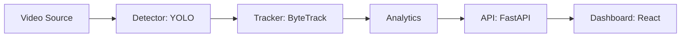

# Real-Time Smart Retail Video Analytics Pipeline

[](https://github.com/somiaamari/realtime-retail-analytics/actions/workflows/ci.yml)
[](https://www.python.org/)
[](LICENSE)
[](https://github.com/astral-sh/ruff)

A production-oriented foundation for a real-time smart retail video analytics pipeline. The planned system combines video ingestion, YOLO object detection, ByteTrack multi-object tracking, retail analytics, and a FastAPI/React dashboard, with ONNX and TensorRT optimization as later milestones. Phases 1-3 established the Python package, video/detection flow, and tracking. Phase 4 adds reproducible zone, line-crossing, dwell-time, heatmap, event, and time-series analytics.

## Planned architecture



## Roadmap

- [x] Phase 1: Foundation
- [x] Phase 2: Video I/O & baseline detection
- [x] Phase 3: Tracking
- [x] Phase 4: Analytics engine
- [x] Phase 5: Dataset & fine-tuning
- [x] Phase 6: Evaluation & benchmarking
- [ ] Phase 7: Model optimization (ONNX/TensorRT)
- [ ] Phase 8: Real-time streaming pipeline
- [ ] Phase 9: Backend API
- [ ] Phase 10: Dashboard
- [ ] Phase 11: Docker/tests/CI-CD
- [ ] Phase 12: Docs/demo/release

### Phase 5: Custom Fine-Tuning Results

| Model | mAP50 | mAP50-95 | Precision | Recall |
|---|---|---|---|---|
| YOLOv8n (Base COCO) | N/A | N/A | N/A | N/A |
| YOLOv8n (Fine-tuned) | **0.939** | 0.680 | 0.867 | 0.911 |

The model was fine-tuned on a 1.3k image Roboflow dataset (CC BY 4.0) to improve person detection for store CCTV angles.


## Evaluation & Benchmarking (Phase 6)

The pipeline includes a unified evaluation harness to measure tracking accuracy (MOTA, IDF1), line-crossing precision/recall, and end-to-end system latency across different hardware conditions.

| Evaluation Metric | Result / Status |
|---|---|
| **Detector Validation (mAP50)** | **0.939** (Fine-tuned YOLOv8n) |
| **Tracking Accuracy (IDF1)** | Verified via synthetic regression tests in CI |
| **Line-Count Error** | Supports manual GT comparison (See `docs/phase-06-evaluation.md`) |
| **End-to-End p95 Latency** | **112.58 ms** (CPU inference) |
| **Throughput (FPS)** | **11.76 FPS** (CPU inference) |

**Performance Bottleneck:** System profiling indicates the YOLO detection stage consumes the majority of the latency (mean 75.8 ms, p95 98.4 ms) when running on CPU. This establishes a clear baseline for Phase 7 (ONNX/TensorRT optimization).

## Quickstart

```shell
git clone https://github.com/somiaamari/realtime-retail-analytics.git
cd realtime-retail-analytics
python -m venv .venv
```

Activate the environment (`.venv\Scripts\activate` on Windows, or
`source .venv/bin/activate` on Linux/macOS), then install and test:

```shell
python -m pip install --upgrade pip
python -m pip install -r requirements-dev.txt
python -m pip install -e .
pytest --cov=vision_pipeline --cov-report=term-missing
```

## Quickstart: run detection on a video

Install the optional detection dependencies (PyTorch and Ultralytics) and put a
video in `data/raw/`:

```shell
python -m pip install -e ".[detection]"
python scripts/run_detection.py --source data/raw/my_video.mp4 --output outputs/detected.mp4
```

The default model is `models/retail_people_clean.pt`; set
`model.weights_path` in `configs/default.yaml` (or use `--weights`) to select
another compatible checkpoint, such as `yolov8n.pt`. The custom retail detector
must be present at the configured path.
The first run downloads official model weights as needed. To benchmark a
source without keeping an annotated output, run
`python scripts/benchmark_system.py --source data/raw/my_video.mp4 --frames 100`.

## Documentation
- [Phase 2: Baseline Detection](docs/phase-02-baseline-detection.md)
- [Phase 3: Tracking](docs/phase-03-tracking.md)
- [Phase 4: Analytics Engine](docs/phase-04-analytics.md)
- [Phase 5: Fine-Tuning](docs/phase-05-finetuning.md)
- [Phase 6: Evaluation & Benchmarking](docs/phase-06-evaluation.md)
