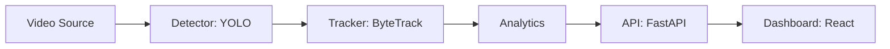
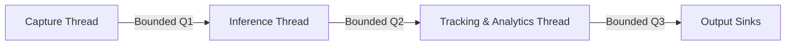

# Real-Time Smart Retail Video Analytics Pipeline

[](https://github.com/somiaamari/realtime-retail-analytics/actions/workflows/ci.yml)
[](https://www.python.org/)
[](LICENSE)
[](https://github.com/astral-sh/ruff)

A production-oriented foundation for a real-time smart retail video analytics pipeline. The planned system combines video ingestion, YOLO object detection, ByteTrack multi-object tracking, retail analytics, ONNX/TensorRT optimization, and a FastAPI/React dashboard. Phases 1-8 established the Python package, detection, tracking, analytics, fine-tuning, evaluation, model optimization, and a concurrent real-time streaming pipeline.

**Phase 10 dashboard:** a responsive live operations and analytics interface with a standalone mock mode. See the [dashboard quick start](dashboard/README.md) and [dashboard architecture](docs/phase-10-dashboard.md). Deploy the static mock demo to Netlify using the instructions in the dashboard guide.

**Phase 7 Performance Comparison:**
By utilizing ONNX Runtime and TensorRT, we achieved a **12x speedup** over the PyTorch CPU baseline, enabling real-time inference at **183 FPS** on an NVIDIA T4 GPU.

| Variant | Environment | FPS | p95 Latency | Model Size | Accuracy Status |
|---|---|---:|---:|---:|---|
| PyTorch FP32 (Baseline) | CPU | 15.09 | 90.50 ms | 6.51 MB | Baseline |
| ONNX FP32 | CPU | 15.49 | 80.66 ms | 12.77 MB | Passed (Parity < 0.01) |
| ONNX FP16 | CPU | 16.17 | 71.11 ms | 6.41 MB | Passed (Parity < 0.01) |
| ONNX INT8 | CPU | 19.10 | 60.05 ms | 6.16 MB | Passed (Parity < 0.01) |
| **TensorRT FP16** | **NVIDIA T4 GPU** | **183.56** | **6.39 ms** | 58.52 MB | **Passed (Parity < 0.01)** |

*Model backend can be switched simply by changing `detector.backend` in `configs/default.yaml`.*

## Planned architecture



## Roadmap

- [x] Phase 1: Foundation
- [x] Phase 2: Video I/O & baseline detection
- [x] Phase 3: Tracking
- [x] Phase 4: Analytics engine
- [x] Phase 5: Dataset & fine-tuning
- [x] Phase 6: Evaluation & benchmarking
- [x] Phase 7: Model optimization (ONNX/TensorRT)
- [x] Phase 8: Real-time streaming pipeline
- [x] Phase 9: Backend API
- [x] Phase 10: Dashboard
- [ ] Phase 11: Docker/tests/CI-CD
- [ ] Phase 12: Docs/demo/release

### Phase 5: Custom Fine-Tuning Results

| Model | mAP50 | mAP50-95 | Precision | Recall |
|---|---|---|---|---|
| YOLOv8n (Base COCO) | N/A | N/A | N/A | N/A |
| YOLOv8n (Fine-tuned) | **0.939** | 0.680 | 0.867 | 0.911 |

The model was fine-tuned on a 1.3k image Roboflow dataset (CC BY 4.0) to improve person detection for store CCTV angles.


## Evaluation & Benchmarking (Phase 6)

The pipeline includes a unified evaluation harness to measure tracking accuracy (MOTA, IDF1), line-crossing precision/recall, and end-to-end system latency across different hardware conditions.

| Evaluation Metric | Result / Status |
|---|---|
| **Detector Validation (mAP50)** | **0.939** (Fine-tuned YOLOv8n) |
| **Tracking Accuracy (IDF1)** | Verified via synthetic regression tests in CI |
| **Line-Count Error** | Supports manual GT comparison (See `docs/phase-06-evaluation.md`) |
| **End-to-End p95 Latency** | **112.58 ms** (CPU inference) |
| **Throughput (FPS)** | **11.76 FPS** (CPU inference) |

**Performance Bottleneck:** System profiling indicates the YOLO detection stage consumes the majority of the latency (mean 75.8 ms, p95 98.4 ms) when running on CPU. This establishes a clear baseline for Phase 7 (ONNX/TensorRT optimization).

## Real-Time Streaming Pipeline (Phase 8)

The threaded pipeline separates capture, inference, tracking/analytics, and output behind bounded queues:



Live streams use bounded queues with a `DROP_OLDEST` policy to maintain bounded latency under heavy load. An adaptive stride controller skips detection frames when the system is bottlenecked while continuing tracking and analytics updates. Threads suit native OpenCV/ONNX work that releases the GIL; multiprocessing may help Python-heavy workloads but requires process-safe queues, frame serialization, and separate model lifecycle management.

Set `video.low_latency: true` to request a one-frame OpenCV capture buffer where the selected backend supports it; RTSP deployments may also configure FFmpeg transport options in their environment.

### Streaming benchmark results

| Mode | Throughput (FPS) | p95 End-to-End Latency (ms) | Frames Dropped | Notes |
|---|---:|---:|---:|---|
| Sync | 4.35 | N/A | N/A | Intel CPU, ONNX |
| Threaded | 4.98 | 1656 | 0 | Intel CPU, ONNX |
| Adaptive | 25.69 | 421 | 0 | Intel CPU, ONNX; final stride 8 |

On constrained hardware (CPU only), the adaptive controller successfully increased the detection stride to maintain 25+ FPS and bounded latency under load.

Run the streaming pipeline on a video file, camera, or RTSP source:

```shell
python scripts/run_live.py --source data/raw/vid.mp4 --realtime --backend onnx
```

Compare synchronous, threaded, and adaptive modes with:

```shell
python scripts/benchmark_streaming.py --source data/raw/vid.mp4
```

For integration, `vision_pipeline.streaming.engine.StreamingPipeline` exposes thread-safe `get_latest_frame()`, `wait_for_frame(version, timeout)`, `subscribe_events(callback_or_queue)`, `get_snapshot()`, `get_metrics()`, and `get_health()` methods. Each instance accepts a `stream_id`; the current implementation uses threads, while process-based execution remains a future option for Python-heavy workloads.

## Backend API (Phase 9)

Install the optional API dependencies and run a no-model synthetic demo:

```shell
python -m pip install -e ".[api,api-dev]"
```

Set `API_DEMO_MODE=true` in `.env`, then run `python scripts/run_api.py`.
The service provides stream lifecycle management, MJPEG video, WebSocket live
updates, and historical analytics backed by SQLite or PostgreSQL. API routes
are documented at `/docs`; migrations are run with `make migrate`. Privacy is
designed in: only anonymous events and coarse aggregates are stored, and
configured retention removes historical records. See
[Phase 9 API documentation](docs/phase-09-api.md).
*To view the live MJPEG video feed in a browser, you can embed the `/video`
endpoint in a simple HTML `` tag.*

## Quickstart

```shell
git clone https://github.com/somiaamari/realtime-retail-analytics.git
cd realtime-retail-analytics
python -m venv .venv
```

Activate the environment (`.venv\Scripts\activate` on Windows, or
`source .venv/bin/activate` on Linux/macOS), then install and test:

```shell
python -m pip install --upgrade pip
python -m pip install -r requirements-dev.txt
python -m pip install -e .
pytest --cov=vision_pipeline --cov-report=term-missing
```

## Quickstart: run detection on a video

Install the optional detection dependencies (PyTorch and Ultralytics) and put a
video in `data/raw/`:

```shell
python -m pip install -e ".[detection]"
python scripts/run_detection.py --source data/raw/my_video.mp4 --output outputs/detected.mp4
```

The default model is `models/retail_people_clean.pt`; set
`model.weights_path` in `configs/default.yaml` (or use `--weights`) to select
another compatible checkpoint, such as `yolov8n.pt`. The custom retail detector
must be present at the configured path.
The first run downloads official model weights as needed. To benchmark a
source without keeping an annotated output, run
`python scripts/benchmark_system.py --source data/raw/my_video.mp4 --frames 100`.

## Documentation
- [Phase 2: Baseline Detection](docs/phase-02-baseline-detection.md)
- [Phase 3: Tracking](docs/phase-03-tracking.md)
- [Phase 4: Analytics Engine](docs/phase-04-analytics.md)
- [Phase 5: Fine-Tuning](docs/phase-05-finetuning.md)
- [Phase 6: Evaluation & Benchmarking](docs/phase-06-evaluation.md)
- [Phase 7: Model Optimization](docs/phase-07-optimization.md)
- [Phase 8: Streaming Pipeline](docs/phase-08-streaming.md)
- [Phase 9: Backend API](docs/phase-09-api.md)
- [WebSocket Protocol](docs/websocket.md)
- [Phase 10: Dashboard](docs/phase-10-dashboard.md)
