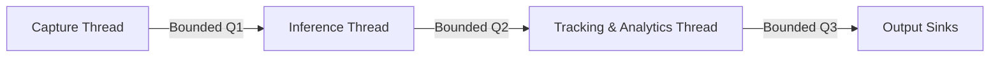

# Phase 8: Real-Time Streaming Pipeline

## Overview

Phase 8 adds a supervised, threaded streaming engine around the existing video
source, detector, ByteTracker, and analytics components. It keeps the
synchronous `AnalyticsPipeline` available for file processing and evaluation,
while offering a low-latency path for live cameras and RTSP streams. The
benchmark below was run on an Intel CPU with the ONNX backend.

## Thread topology



The capture thread reads frames, attaches the stream ID and monotonic capture
timestamp, and submits them to Q1. The inference thread runs detector calls at
the configured stride. The tracking/analytics thread updates ByteTracker and
the analytics engine on every accepted frame, renders overlays, and publishes
a result. Output sinks consume results independently; slow sinks use their own
bounded queues so file or network output cannot hold up inference.

For file processing, queues can use blocking backpressure and capture can be
paced to the source frame rate. Live sources use `DROP_OLDEST` so the next stage
receives recent frames instead of working through an increasingly stale
backlog.

## Why bounded queues?

Little's Law relates the average number of items in a system (`L`) to arrival
rate (`lambda`) and average time in the system (`W`): `L = lambda * W`. If
frames arrive faster than CPU-bound inference can process them, an unbounded
queue grows continuously and latency rises with it. Bounded queues cap the
number of frames waiting at each stage.

For a live stream, `DROP_OLDEST` is the useful overflow policy: it discards
stale queued frames and keeps the freshest available frame. Blocking capture
would simply move the backlog into a camera or RTSP decoder buffer, while
`DROP_NEWEST` preserves the old backlog. The measured Threaded result illustrates
the consequence of running detection on every frame under the CPU bottleneck:
latency reached **1656 ms**. Live mode therefore uses bounded queues and
deliberate drops rather than allowing delay to grow without limit. The benchmark
reported zero drops for its finite input; queue overflow is load-dependent.

## Adaptive stride trade-off

The adaptive controller smooths observed end-to-end latency with an
exponentially weighted moving average and uses queue depth plus configurable
hysteresis to avoid reacting to a single slow frame. When latency exceeds its
budget or input queues build up, it increases the detection stride, within the
configured minimum and maximum. When latency remains comfortably below budget
and queues are clear, it can reduce the stride again.

At stride 8, detection runs once for each eight-frame interval; in between,
ByteTracker's `predict_only(frame_id)` advances the Kalman state without
creating new identities. Tracking output and analytics continue on those
frames, keeping the display current while reducing expensive detector work.
The controller forces a fresh detection at the configured maximum detection
age, when that safeguard is enabled.

On the Intel CPU with ONNX, the adaptive benchmark increased stride to **8**,
reached **25.69 FPS**, and measured **421 ms p95 end-to-end latency**, with
**zero frames dropped** on that finite input. This is the measured trade-off:
fewer detector updates in exchange for much higher throughput and lower latency.
The reported 421 ms is bounded by the measured run, not a hard real-time
guarantee; camera, backend, and workload differences affect actual latency.

## Benchmark results

| Mode | Environment | Throughput | p95 end-to-end latency | Frames dropped | Final stride |
|---|---|---:|---:|---:|---:|
| Sync | Intel CPU, ONNX | 4.35 FPS | N/A | N/A | 1 |
| Threaded | Intel CPU, ONNX | 4.98 FPS | 1656 ms | 0 | 1 |
| Adaptive | Intel CPU, ONNX | 25.69 FPS | 421 ms | 0 | 8 |

These are machine-specific measurements supplied from a local benchmark run;
they are not CI performance thresholds.

## Integration API for Phase 9

Each `StreamingPipeline` instance has its own `stream_id` and exposes
thread-safe integration methods:

- `get_latest_frame() -> EncodedFrame | None`: returns the most recent annotated
  frame as JPEG, encoding lazily and caching by frame version.
- `wait_for_frame(version, timeout) -> EncodedFrame | None`: waits for a frame
  newer than the caller's version.
- `subscribe_events(callback_or_queue)`: subscribes a callback or queue to
  analytics events. Callback delivery is isolated from pipeline stages, and
  queue subscribers are offered events without blocking the pipeline.
- `get_snapshot()`: returns the latest analytics snapshot.
- `get_metrics()`: returns counters, frame rates, queue depths and policies,
  stage latency/utilization, end-to-end latency, stride, reconnects, and the
  current bottleneck.
- `get_health()`: reports the stream health state, stage progress, reconnect
  status, and failure context.

`StreamMetrics.to_prometheus()` provides plain-text metric export for a future
API endpoint. The library does not install signal handlers; applications such
as `scripts/run_live.py` own SIGINT/SIGTERM handling and invoke orderly
shutdown.

## Threading and the GIL

Threads are a good fit for this pipeline because OpenCV image operations and
ONNX Runtime inference execute substantial work in native code and release the
Python GIL. That allows capture, inference, and output to overlap without
introducing process serialization and model-copy costs. For workloads dominated
by Python bytecode, threads may not scale across cores; multiprocessing remains
a possible future option, with additional costs for transferring frames and
managing detector instances across processes.

## Running and benchmarking

Run a source through the threaded pipeline:

```shell
python scripts/run_live.py --source data/raw/vid.mp4 --realtime --backend onnx
```

Compare synchronous, threaded, and adaptive modes:

```shell
python scripts/benchmark_streaming.py --source data/raw/vid.mp4 --backend onnx
```
