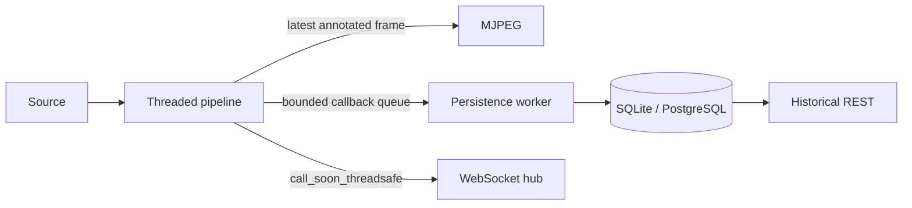

# Phase 9: Backend API

## Architecture

`create_app()` wires an environment-backed settings object, SQLAlchemy engine,
Alembic migrations, `StreamManager`, `PersistenceWorker`, and a bounded
WebSocket hub. `StreamManager` owns the Phase 8 threaded pipelines. Pipeline
callbacks enqueue events without database access, and hand off hub broadcasts
using `loop.call_soon_threadsafe`. A separate writer thread batches event writes.
SQLite uses WAL and foreign-key enforcement; PostgreSQL is supported by setting
`API_DATABASE_URL`.



## Data model

`streams` 1—N `runs`; `events`, `bucket_stats`, `zones`, `lines`,
`heatmap_snapshots`, and `dwell_records` are indexed by stream and relevant
timestamp fields. Events have a stream/time and event-type index; time buckets
have a stream/bucket-start index. Geometry uses JSON columns. The schema is
created exclusively through Alembic migrations (not application `create_all`).

## Privacy and retention

The service persists only anonymous analytics events and coarse aggregates.
Track IDs are session-local integers; no images, faces, raw frames, or biometric
data are written to the database. Configure `API_RETENTION_DAYS` to control
historical row retention. Source credentials should be managed outside checked
in configuration. Protect non-local deployments with API keys and TLS.

## Local setup

```powershell
python -m pip install -e ".[api,api-dev]"
Copy-Item .env.example .env
$env:API_DEMO_MODE = "true"
python scripts/run_api.py
```

The synthetic demo stream uses `FakeSource` and `FakeDetector`, needs no GPU,
camera, model artifact, or network access. `make migrate`, `make seed`,
`make openapi`, and `python scripts/load_test_api.py` provide migration,
deterministic sample data, contract output, and a 60-second soak test.
Browsers do not render MJPEG when you navigate to its URL directly; to view the
stream, embed the `/video` endpoint in a simple HTML `` tag.

## Endpoint reference

See the OpenAPI contract in [`openapi.json`](./openapi.json). Main endpoint
groups:

- System: `/api/v1/health`, `/api/v1/ready`, `/api/v1/info`, `/api/v1/metrics`.
- Streams: `/api/v1/streams` CRUD, lifecycle actions, live metrics/health/snapshot,
  and zones/lines configuration.
- Video: `/api/v1/streams/{id}/video` (MJPEG), `/frame.jpg`.
- Analytics: `/api/v1/streams/{id}/analytics/{summary,timeseries,peak-hours,zones,dwell,heatmap,heatmap.png}`.
- Events: `/api/v1/streams/{id}/events` and `/events/export.csv`.
- Realtime: `/ws/streams/{id}`.

Mutating endpoints require `X-API-Key` if `API_API_KEY` is configured.
WebSockets use an `api_key` query parameter in that mode.

## Load and soak

The load utility opens 50 WebSocket sessions, 5 MJPEG streams, and REST polling
for 60 seconds. The local load-test results were:

- Duration: 60 seconds
- WebSocket messages: 8,602
- MJPEG chunks: 5
- REST requests: 208

This demonstrates that the WebSocket hub successfully pushed approximately
143 messages per second without blocking the pipeline. The in-process test
suite exercises deterministic fake pipelines and temporary SQLite databases
without network or GPU access.
